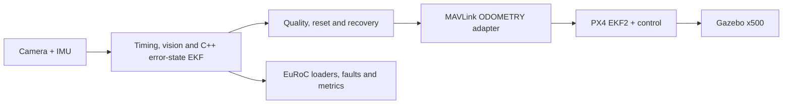

# Visual-Inertial UAV Navigation

A modern C++/Python robotics portfolio project for GPS-denied UAV navigation: calibrated camera/IMU interfaces, a 15-state error-state EKF, estimator health and recovery, geometric vision, PX4 external vision, reproducible fault injection, and headless Gazebo acceptance scenarios.

## Verified outcomes

| Area | Retained result |
|---|---:|
| Python tests | 57 passed |
| C++ tests | 9 passed |
| GPS-denied PX4 mission | 5/5 waypoints |
| Maximum settled waypoint error | 0.883 m |
| Mission landing/disarm | passed |
| Estimator-loss response | Descend / blind land |
| Loss-to-failsafe transition | 0.658 s |
| Synthetic frontend p95 | 1.445 ms/frame |
| Process maximum RSS | 78.34 MiB |

The PX4 mission uses independent Gazebo ground truth as a simulated external-vision source. It proves the frame conversion, MAVLink transport, EKF2 configuration, Offboard control and failsafe boundary—not camera-derived trajectory accuracy.

## System architecture



The C++ core remains independent of PX4 and transport middleware. See the [detailed architecture and failsafe sequence](docs/architecture.md).

## Implemented engineering

- Typed camera, IMU, calibration, rigid-transform and coordinate-frame contracts.
- Nearest timestamp association and deterministic camera/IMU offset estimation.
- Grayscale/CLAHE preprocessing, feature detection, pyramidal LK tracking, forward/backward gating and essential-matrix RANSAC.
- Ordered C++ IMU buffer, interpolation, bias model, preintegration and stationary gravity initialisation.
- Fifteen-state multiplicative error-state EKF with IMU propagation, visual pose updates, covariance and innovation diagnostics.
- TRACKING / DEGRADED / LOST / RESETTING health model with bounded recovery and real EKF reset.
- Keyframe database, loop-candidate retrieval and translation pose-graph correction prototype.
- MAVLink 2 external-vision adapter with ENU/FLU to NED/FRD conversion, covariance, timestamps, quality gating and reset counter.
- PX4/Gazebo GPS-denied waypoint and estimator-loss failsafe acceptance.
- EuRoC loaders, SE(3) alignment, ATE/RPE metric tooling, fault injection, latency and resource profiling.

## Reproduce the evidence

```bash
python3 -m venv .venv
.venv/bin/python -m pip install -e . pytest
./tools/run_demo.sh offline
```

Review retained SITL results without launching PX4:

```bash
./tools/run_demo.sh evidence
```

For the pinned live PX4/Gazebo commands, see the [clean-machine demo guide](docs/demo.md).

## Evidence map

- [Measured benchmark report](docs/benchmark.md)
- [Machine-readable benchmark summary](docs/generated/final-benchmark.json)
- [GPS-denied mission result](simulation/px4/evidence/m6-t03-mission.json)
- [Estimator-loss failsafe result](simulation/px4/evidence/m6-t04-failsafe.json)
- [Recruiter evidence and CV bullets](docs/recruiter-evidence.md)
- [Interview pack](docs/interview-pack.md)

## Validation boundary

This is workstation and PX4/Gazebo SITL evidence. EuRoC loaders and ATE/RPE tooling are tested, but there is no end-to-end EuRoC camera/IMU estimator run, so no EuRoC accuracy is claimed. There is also no physical camera/IMU-rig validation, ARM flight-computer profiling, physical flight, production deployment, flight-worthiness claim or safety certification.
