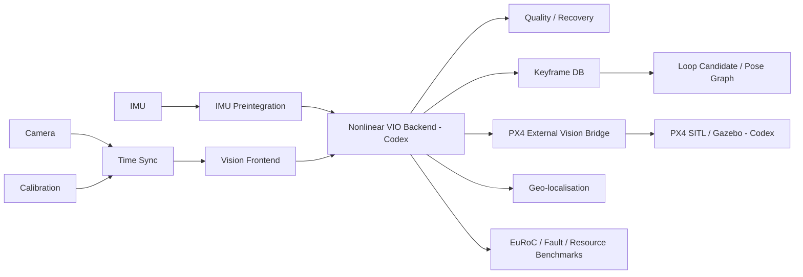

# Visual-Inertial UAV Navigation

A portfolio-grade robotics software project for **GPS-denied aerial navigation**, focused on modern C++, Linux, visual-inertial estimation, geometric vision, sensor fusion, visual SLAM interfaces, embedded deployment and PX4 integration.

> **Validation boundary:** the calibration, geometric-vision, IMU, estimator-health, keyframe/loop-candidate, geo-localisation, benchmark and deployment-support layers are tested locally. The nonlinear VIO backend and PX4 SITL integration remain explicit Work/Codex milestones. No physical UAV or flight-readiness claim is made.

## What is implemented before Codex

### C++ core
- typed camera / IMU / calibration contracts
- rigid-transform validation
- timestamp synchronisation
- IMU ring buffer + interpolation
- gyro/accelerometer bias model
- IMU preintegration foundation
- stationary gravity initialisation
- estimator tracking-state machine
- estimator quality scoring + reset/recovery supervisor
- keyframe database + loop-candidate retrieval

### Vision / autonomy tooling
- grayscale / CLAHE preprocessing
- feature detection
- pyramidal LK tracking
- forward/backward track validation
- essential-matrix RANSAC
- keyframe policy
- EuRoC camera/IMU/ground-truth loaders
- ATE/RPE and SE(3) trajectory alignment tooling
- camera/IMU time-offset estimation
- dropped-frame / IMU-gap fault injection
- translation pose-graph correction prototype
- offline ORB + homography geo-localisation with confidence gating

### PX4 / embedded boundaries
- ENU <-> NED conversion
- typed external-vision sample contract
- GPS-denied mission fixture
- estimator-loss failsafe fixture
- SITL launch wrapper/spec
- ARM64 cross-build Docker/toolchain profile
- watchdog/failsafe supervisor
- synthetic real-time video benchmark
- process resource profiling

## Architecture



## Verified local baseline

At the aggressive pre-Codex checkpoint:

- **50 Python tests passing**
- **6/6 C++ tests passing**
- formal task graph: **29/39 complete**
- pre-Codex gate: **PASS**

## Measured pre-backend evidence

These are local frontend/runtime measurements only—not full VIO, PX4, ARM hardware or production performance.

### Synthetic 640x480 vision frontend — 100 frames

- mean latency: ~4.25 ms/frame
- p50: ~3.91 ms
- p95: ~5.74 ms
- max: ~22.03 ms
- mean detected features: ~158

### Process resource profile — 100 frames

- mean wall time: ~3.69 ms/frame
- max RSS observed: ~153 MB

### Retained quality/fault transitions

- nominal -> TRACKING
- 15 ms camera/IMU residual -> DEGRADED
- 40 ms residual -> LOST
- moderate frame loss -> DEGRADED
- severe frame loss -> LOST
- 50 ms IMU gap -> DEGRADED
- 150 ms IMU gap -> LOST

These validate the **health policy around the future estimator**, not trajectory accuracy.

## Run the pre-Codex gate

```bash
python tools/pre_codex_gate.py
```

It checks:

- Python tests
- Python compileability
- fresh C++ configure/build/tests
- video benchmark smoke test
- retained fault campaign
- resource-profile smoke test

## Deliberately left for Codex / Work

Only the high-value integration tasks remain:

1. real nonlinear VIO estimator backend
2. integrate actual estimator covariance/residuals into quality output
3. integrate reset/reinitialisation into the real estimator
4. PX4 SITL + Gazebo launch/validation
5. real MAVLink/MAVSDK external-vision transport
6. GPS-denied waypoint mission
7. estimator-loss failsafe in SITL
8. final clean-machine demo
9. final integrated benchmark/report
10. final recruiter README/interview pack based on integrated evidence

See `WORK_HANDOFF_PROMPT.md` and `docs/context/CURRENT_STATE.md`.

## Honesty / safety boundary

This repository does **not** claim:

- physical flight validation
- flight-worthiness
- safety certification
- PX4 mission completion before SITL evidence exists
- ARM hardware performance before real ARM profiling exists
