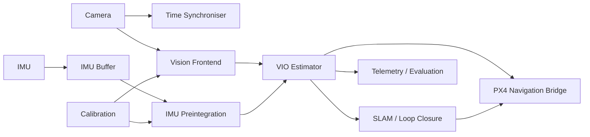

# Detailed Architecture

The project is intentionally split into a middleware-independent estimation core and adapters.

## Design goals
- deterministic replay from recorded data
- measurable estimator quality
- explicit degraded/lost states
- portable core C++ library
- testable without flight hardware
