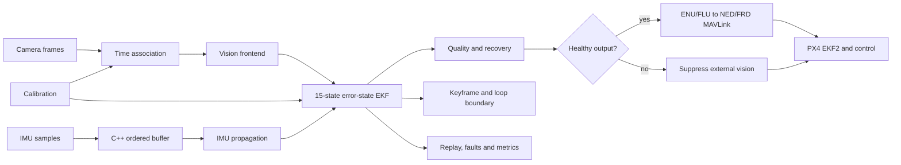
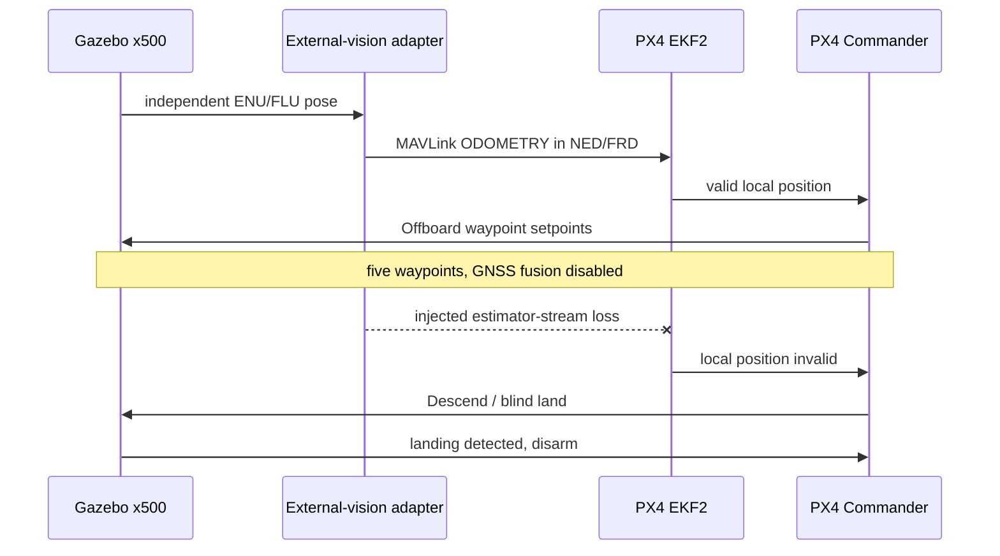

# Architecture

The estimator core is independent of PX4 and transport middleware. Python owns dataset, vision, benchmark and simulator orchestration; modern C++ owns the timing, IMU, estimator, health and recovery core.

## Data and control flow

## GPS-denied SITL sequence

## Validation boundaries

- Deterministic tests cover contracts, estimation, health, reset and recovery.
- PX4/Gazebo covers simulated transport, fusion, waypoint control and failsafe response.
- EuRoC loaders and metrics exist, but full-dataset VIO accuracy has not been measured.
- No physical camera/IMU rig, flight hardware, production deployment or safety certification is claimed.
